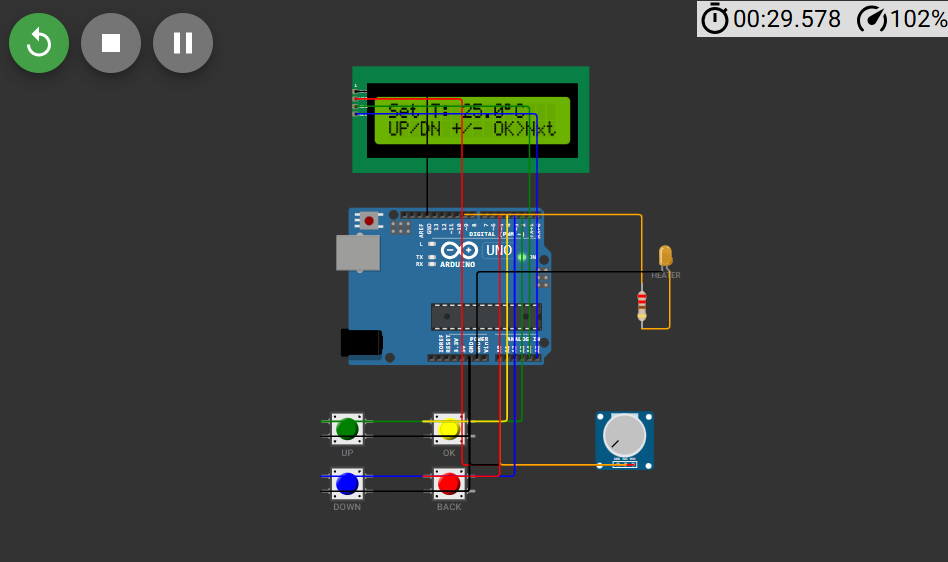
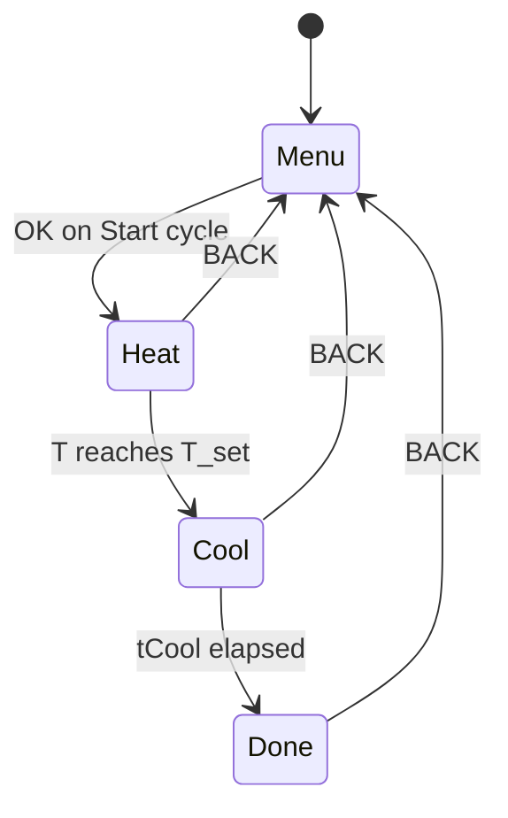
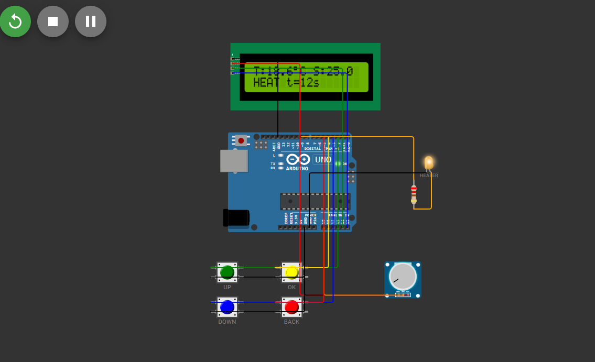
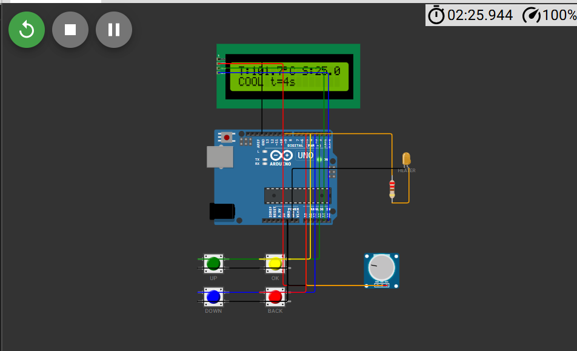
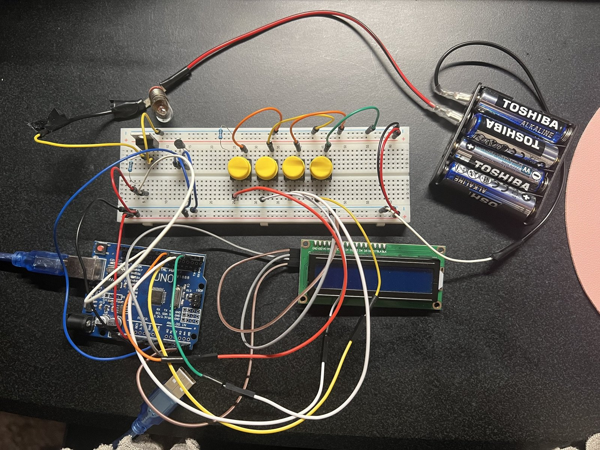

# Temperature Controller (Arduino Uno + LM35)

An embedded temperature control system built on an Arduino Uno (ATmega328P), written in C++.
The system heats an incandescent bulb until the temperature measured by an LM35 sensor reaches a user-defined set point, then switches the heater off and times a cooling period.
All parameters are set from a 16x2 LCD menu using four push buttons.

**▶ Try it in the browser: [Wokwi simulation](https://wokwi.com/projects/481035184017757185)**



## Features

- Temperature measurement with an LM35 analog sensor, averaged over 32 ADC samples
- On/off heater control through a TIP31C power transistor
- Heating, cooling and done phases implemented as a finite state machine
- 1 Hz time base generated by **Timer1 in CTC mode**, configured directly through the ATmega328P registers
- LCD menu for the set point and the cooling time, navigated with four buttons
- The heater is switched off whenever the system is in the menu, after the set point is reached, or when the cycle is aborted
- Debug output on the serial port (9600 baud): raw ADC value, voltage and temperature every second, plus the name of each pressed button

## How it works



| Phase | Heater | What happens | LCD line 2 |
|---|---|---|---|
| Menu | off | The user sets `T_set` and `tCool` | menu text |
| Heat | **on** | Runs until the measured temperature reaches `T_set`; the heating time is recorded | `HEAT t=<seconds>s` |
| Cool | off | Waits `tCool` seconds | `COOL t=<seconds>s` |
| Done | off | Shows how long the heating took | `DONE Th=<seconds>s` |

During a cycle, line 1 of the LCD shows the current temperature and the set point, for example `T:18.6°C S:25.0`.

A cycle only starts if `T_set` is more than 0.5 °C above the current temperature. Otherwise the LCD shows `Tset < Tcur!` together with the current temperature for 2 seconds and returns to the menu.

| Heating | Cooling |
|---|---|
|  |  |

### Timing

Timer1 runs in CTC (Clear Timer on Compare Match) mode with a prescaler of 1024 and `OCR1A = 15624`:

```
16 MHz / 1024 / (15624 + 1) = 1 Hz
```

The interrupt service routine only sets a flag (`tick1s`). The main loop checks the flag, reads the temperature, advances the state machine and refreshes the LCD once per second.

### Temperature reading

The first ADC reading is discarded, then 32 readings taken 200 µs apart are averaged.
The average is converted to a voltage (`raw × 5 V / 1023`), and the LM35 output of 10 mV/°C gives the temperature (`voltage × 100`).

## Controls

| Button | In the menu | During a cycle |
|---|---|---|
| UP | Increase the selected value | – |
| DOWN | Decrease the selected value | – |
| OK | Next menu item / start the cycle | – |
| BACK | Previous menu item | Abort the cycle and return to the menu |

| Parameter | Default | Range | Step |
|---|---|---|---|
| `T_set` (set point) | 25.0 °C | 10.0 – 80.0 °C | 0.5 °C |
| `tCool` (cooling time) | 60 s | 10 – 999 s | 10 s |

## Hardware



| Component | Role |
|---|---|
| Arduino Uno (ATmega328P) | Microcontroller |
| LM35 | Analog temperature sensor (10 mV/°C) |
| Incandescent bulb | Heating element, placed next to the sensor |
| TIP31C NPN transistor | Switches the bulb, which is powered from a separate battery supply |
| 16x2 LCD with I2C backpack (address `0x27`) | Display |
| 4 push buttons | User input |

### Wiring

| Arduino pin | Connected to |
|---|---|
| A0 | LM35 output |
| D9 | TIP31C base (heater control) |
| D2 | UP button |
| D3 | DOWN button |
| D4 | OK button |
| D5 | BACK button |
| A4 (SDA) | LCD SDA |
| A5 (SCL) | LCD SCL |
| 5V / GND | LCD, LM35 |

Each button connects its pin to GND. The pins use the internal pull-up resistors, so a pressed button reads `LOW`.

## Build and run

1. Install the [Arduino IDE](https://www.arduino.cc/en/software).
2. In the Library Manager, install **LiquidCrystal I2C** by Frank de Brabander.
3. Open `temperature_controller/temperature_controller.ino`.
4. Select **Tools → Board → Arduino AVR Boards → Arduino Uno**.
5. Click **Verify** to compile, or **Upload** with the board connected.

## Simulation

The project runs in the [Wokwi simulator](https://wokwi.com/projects/481035184017757185). The circuit definition is in [`simulation/diagram.json`](simulation/diagram.json).

In the simulation:

- the LM35 is replaced by a **potentiometer** on A0. Turning it changes the voltage, and therefore the temperature the program reads (0–5 V corresponds to 0–500 °C).
- the bulb is replaced by an **LED** on D9, which lights up while the heater is on.
- the buttons can also be pressed from the keyboard: ↑ (UP), ↓ (DOWN), Enter (OK), Esc (BACK).

## Project structure

```
temperature-control-embedded/
├── temperature_controller/
│   └── temperature_controller.ino   # Arduino sketch
├── simulation/
│   ├── diagram.json                 # Wokwi circuit
│   └── libraries.txt                # Libraries used by the simulation
├── images/                          # Screenshots from the simulation
└── README.md
```